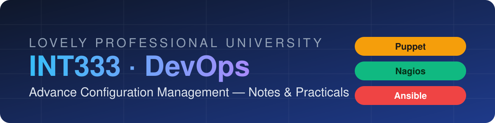
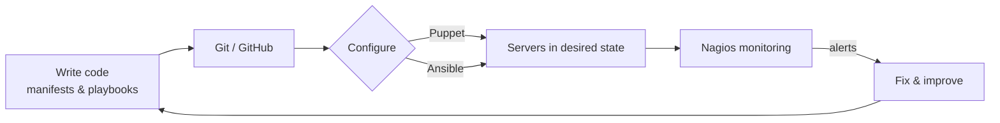

<p align="center">
  
</p>

<p align="center">
  
  
  
</p>
<p align="center">
  
  
  
  
  
  
</p>

# INT333 — DevOps Advance Configuration Management

Class notes, practical files and quick-reference sheets for **INT333** at **Lovely Professional University**, prepared by **Muhammed Shaan**.

> The course covers three industry-standard tools: **Puppet** (desired-state configuration), **Nagios** (infrastructure monitoring) and **Ansible** (agentless automation).

## 🗺️ How the pieces fit



## 📖 Contents

### 📚 Notes
| Unit | Topic |
|:---:|-------|
| 1 | [Puppet Basics](notes/unit-1-puppet-basics.md) |
| 2 | [Advanced Puppet](notes/unit-2-advanced-puppet.md) |
| 3 | [Overview of Nagios](notes/unit-3-nagios-overview.md) |
| 4 | [Working with Nagios](notes/unit-4-working-with-nagios.md) |
| 5 | [Ansible Basics](notes/unit-5-ansible-basics.md) |
| 6 | [Ansible Advanced](notes/unit-6-ansible-advanced.md) |

### 🛠️ Practicals
| # | Practical | Tool |
|:-:|-----------|:----:|
| 1 | [Install Puppet & first manifest](practicals/01-puppet-installation) | 🟠 Puppet |
| 2 | [Resources, ordering & classes](practicals/02-puppet-resources-and-classes) | 🟠 Puppet |
| 3 | [Modules, templates & master–agent](practicals/03-puppet-modules-and-master-agent) | 🟠 Puppet |
| 4 | [Install Nagios Core](practicals/04-nagios-installation) | 🟢 Nagios |
| 5 | [Monitor hosts & services](practicals/05-nagios-monitor-hosts-and-services) | 🟢 Nagios |
| 6 | [NRPE remote monitoring + custom plugin](practicals/06-nagios-nrpe) | 🟢 Nagios |
| 7 | [Ansible install, inventory & ad-hoc](practicals/07-ansible-adhoc-and-inventory) | 🔴 Ansible |
| 8 | [Playbooks, templates, vault & roles](practicals/08-ansible-playbooks-and-roles) | 🔴 Ansible |

### 🧾 Extras
- 🧪 [Lab environment (Vagrant, 3 VMs)](lab)
- 📄 Cheat-sheets: [Puppet](cheatsheets/puppet.md) · [Nagios](cheatsheets/nagios.md) · [Ansible](cheatsheets/ansible.md)
- 🚀 [Project / CA template](project)

## ⚡ Quick start

```bash
git clone https://github.com/MuhammedShaanTT/INT-333.git
cd INT-333/lab
vagrant up                 # 3 Ubuntu 22.04 VMs: control, node1, node2
vagrant ssh control
```
Then follow [`practicals/`](practicals) in order.

## 🌳 Repository structure

```
INT-333/
├── assets/            banner
├── lab/               Vagrantfile + lab guide
├── notes/             unit-wise class notes (6 units)
├── practicals/        8 practicals with code, configs, viva questions
├── cheatsheets/       Puppet · Nagios · Ansible
├── project/           CA/project template
├── LICENSE
└── README.md
```

## ✅ Tested environment
Ubuntu 22.04 LTS · Puppet 8 · Nagios Core 4.5.x + Plugins 2.4.x · Ansible (apt `ansible` package) · VirtualBox + Vagrant.
Always verify package/tool versions against official sites before running.

## 🙋 Author
**Muhammed Shaan** · B.Tech CSE, Lovely Professional University  
GitHub: [@MuhammedShaanTT](https://github.com/MuhammedShaanTT)

## 📜 License
Released under the [MIT License](LICENSE). Notes are for study purposes; refer to the official documentation of [Puppet](https://www.puppet.com/docs), [Nagios](https://www.nagios.org/documentation/) and [Ansible](https://docs.ansible.com/) for authoritative details.
"# INT-333" 
