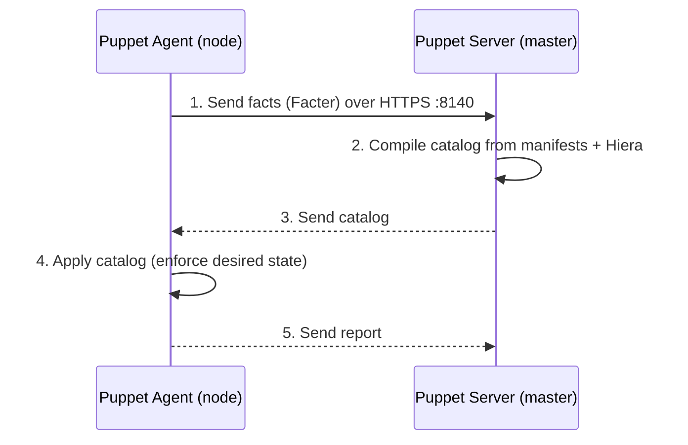

# Unit 1 — Puppet Basics

[← Notes index](README.md) · [Next: Unit 2 →](unit-2-advanced-puppet.md)

## 1. Configuration management in one minute
Configuration management (CM) keeps many servers in a **known, repeatable state** using code instead of manual commands.
Benefits: consistency, no configuration drift, fast rebuilds, version-controlled infrastructure ("Infrastructure as Code").

## 2. What is Puppet?
- Open-source, **declarative**, model-driven CM tool written in Ruby.
- You describe the **desired state** ("package nginx must be installed and running"); Puppet works out *how* to get there.
- **Idempotent** – running the same code again changes nothing if the system is already correct.
- Works on Linux, Windows, macOS, and many network devices.

## 3. Architecture (master/agent)



| Component | Role |
|-----------|------|
| **Puppet Server** | Central server; compiles catalogs. Listens on port **8140**. |
| **Puppet Agent** | Runs on each node; requests and applies its catalog (default every 30 min). |
| **Facter** | Collects system facts (OS, IP, memory…) used in manifests. |
| **Catalog** | Compiled list of resources and their relationships for one node. |
| **Hiera** | Key/value data lookup – keeps data separate from code. |
| **PuppetDB** | Optional store for facts, catalogs, reports. |
| **Puppet Forge** | Public repository of community modules. |

Standalone mode: `puppet apply file.pp` – no server needed (used for quick tests).

## 4. Key vocabulary
| Term | Meaning |
|------|---------|
| **Resource** | Smallest unit: `file`, `package`, `service`, `user`, `exec`, `cron`… |
| **Resource type** | The kind of thing being managed (`package`). |
| **Provider** | Platform-specific implementation of a type (`apt`, `yum`). |
| **Manifest** | A `.pp` file containing Puppet code. |
| **Class** | Named group of resources, declared once per node. |
| **Module** | Self-contained directory of manifests, files, templates. |
| **Node** | A managed machine. |
| **Resource Abstraction Layer (RAL)** | Lets you write one resource that works on many OSes. |

## 5. Puppet language basics
```puppet
# Resource syntax:  type { 'title': attribute => value, }
package { 'nginx':
  ensure => installed,
}

service { 'nginx':
  ensure  => running,
  enable  => true,
  require => Package['nginx'],   # ordering
}

file { '/var/www/html/index.html':
  ensure  => file,
  content => "Hello from ${facts['networking']['hostname']}\n",
  mode    => '0644',
}
```

### Data types & variables
`String`, `Integer`, `Float`, `Boolean`, `Array`, `Hash`, `Undef`. Variables start with `$` and are assigned once:
```puppet
$packages = ['git', 'curl', 'vim']
$app      = { 'name' => 'demo', 'port' => 8080 }
```

### Conditionals
```puppet
if $facts['os']['family'] == 'Debian' { $web = 'apache2' } else { $web = 'httpd' }

case $facts['os']['family'] {
  'Debian': { $web = 'apache2' }
  'RedHat': { $web = 'httpd'   }
  default : { fail('unsupported OS') }
}
```

### Ordering & relationships
| Metaparameter | Arrow | Meaning |
|---------------|-------|---------|
| `before`      | `->`  | Apply me **before** the target |
| `require`     | `<-`  | Apply the target **before** me |
| `notify`      | `~>`  | Like `before`, and **refresh** the target if I changed |
| `subscribe`   | `<~`  | Like `require`, and refresh me if the target changed |

## 6. Installing Puppet (Ubuntu 22.04, Puppet 8)
```bash
wget https://apt.puppet.com/puppet8-release-jammy.deb
sudo dpkg -i puppet8-release-jammy.deb && sudo apt update
sudo apt install -y puppet-agent            # agent only
sudo apt install -y puppetserver            # on the master
export PATH=$PATH:/opt/puppetlabs/bin       # puppet, facter, hiera binaries
puppet --version
```
Important paths: `/etc/puppetlabs/puppet/puppet.conf`, `/etc/puppetlabs/code/environments/production/`, `/opt/puppetlabs/bin/`.

## 7. Essential commands
| Command | Purpose |
|---------|---------|
| `puppet apply site.pp` | Apply a manifest locally |
| `puppet apply --noop site.pp` | Dry run – show what *would* change |
| `puppet parser validate site.pp` | Syntax check |
| `puppet resource package nginx` | Inspect a resource's current state |
| `facter` / `facter os` | Show facts |
| `puppet agent -t` | Run the agent once, verbose |
| `puppet module install puppetlabs-apache` | Install a Forge module |

## ✍️ Quick revision questions
1. Define *declarative* and *idempotent* with a Puppet example.
2. Draw the master–agent workflow.
3. What is the difference between `require` and `notify`?
4. What is a catalog? Who compiles it?
5. Why is Facter needed?
