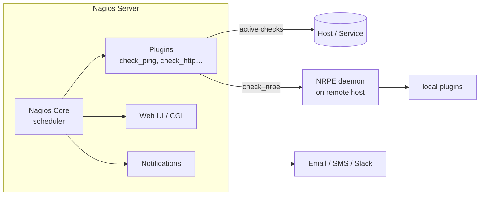

# Unit 3 — Overview of Nagios

[← Unit 2](unit-2-advanced-puppet.md) · [Notes index](README.md) · [Next: Unit 4 →](unit-4-working-with-nagios.md)

## 1. Why monitoring?
Monitoring detects failures **before users do**, tracks capacity, and gives data for troubleshooting. In DevOps it closes the loop: *plan → code → build → test → release → deploy → operate → **monitor***.

## 2. What is Nagios?
- Open-source **infrastructure monitoring** system (Nagios Core), originally NetSaint.
- Monitors **hosts** (servers, routers, printers) and **services** (HTTP, SSH, disk, CPU, MySQL…).
- Sends **alerts** (email, SMS, scripts) and shows status on a **web interface**.
- Extensible through **plugins** – any program that prints one line and returns an exit code.

## 3. Architecture

| Part | Description |
|------|-------------|
| **Core engine** | Schedules checks, processes results, decides state, triggers notifications. |
| **Plugins** | Executables in `/usr/local/nagios/libexec` (source install) or `/usr/lib/nagios/plugins` (apt). |
| **Config files** | Plain-text object definitions in `/usr/local/nagios/etc/`. |
| **Web interface** | CGI scripts served by Apache – status map, problems, reports. |
| **Add-ons** | NRPE, NSCA, NDOUtils, Nagvis, PNP4Nagios, Nagios XI (commercial). |

## 4. Active vs passive checks
| | Active | Passive |
|---|--------|---------|
| Initiated by | Nagios | External app (e.g. NSCA, scripts) |
| Good for | Normal polling | Firewalled hosts, asynchronous events, traps |

## 5. States and exit codes
| Exit code | Service state | Host state |
|-----------|---------------|------------|
| 0 | **OK** | UP |
| 1 | **WARNING** | UP (default) |
| 2 | **CRITICAL** | DOWN |
| 3 | **UNKNOWN** | — |

- **Soft state**: problem detected, but `max_check_attempts` not yet reached (no notification).
- **Hard state**: confirmed after retries → notification sent.
- **Flapping**: state keeps changing; Nagios detects and suppresses noisy alerts.

## 6. Core object types (preview of Unit 4)
`host` · `hostgroup` · `service` · `servicegroup` · `command` · `contact` · `contactgroup` · `timeperiod`.

## 7. Installation overview (Ubuntu, from source)
1. Install dependencies (`apache2 php build-essential libgd-dev openssl libssl-dev autoconf …`).
2. Download and compile **Nagios Core**.
3. Create user `nagios`, group `nagcmd`/`nagios`, add `www-data` to the group.
4. Install and enable web config; create `nagiosadmin` with `htpasswd`.
5. Compile **nagios-plugins**.
6. Verify config → start service → open `http://<ip>/nagios`.

Script: [`practicals/04-nagios-installation/install_nagios.sh`](../practicals/04-nagios-installation/install_nagios.sh).

## ✍️ Quick revision questions
1. Explain Nagios architecture with a diagram.
2. Active vs passive checks – when would you use each?
3. What do the plugin exit codes 0/1/2/3 mean?
4. Soft state vs hard state?
5. Name four Nagios add-ons and their purpose.
