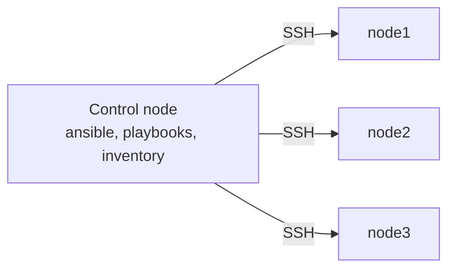

# Unit 5 — Ansible Basics

> ⚠️ **Check against your official handout.** The unit title is inferred from the course's OER list (Puppet → Nagios → Ansible). Re-label if your syllabus differs.

[← Unit 4](unit-4-working-with-nagios.md) · [Notes index](README.md) · [Next: Unit 6 →](unit-6-ansible-advanced.md)

## 1. What is Ansible?
- Open-source **automation** tool (Red Hat) for configuration management, deployment and orchestration.
- **Agentless** – uses **SSH** (Linux) / WinRM (Windows); nothing to install on managed nodes except Python.
- **YAML** playbooks, **push** model, **idempotent** modules.

| | Puppet | Ansible |
|---|--------|---------|
| Language | Puppet DSL (Ruby-like) | YAML |
| Agent | Yes | No (SSH) |
| Model | Pull (agent asks master) | Push (control node pushes) |
| Setup | Master + certs | Inventory + SSH keys |

## 2. Architecture



Terms: **control node**, **managed nodes**, **inventory**, **module**, **task**, **play**, **playbook**, **role**, **handler**, **facts**, **variables**, **collection**.

## 3. Installation & SSH setup
```bash
sudo apt update && sudo apt install -y ansible     # or: pipx install ansible
ansible --version
ssh-keygen -t ed25519                              # on control node
ssh-copy-id vagrant@192.168.56.11                  # repeat for each node
```

## 4. Inventory
`inventory.ini`
```ini
[web]
node1 ansible_host=192.168.56.11
[db]
node2 ansible_host=192.168.56.12
[all:vars]
ansible_user=vagrant
ansible_python_interpreter=/usr/bin/python3
```
Inventories can also be YAML or dynamic (cloud plug-ins). Default: `/etc/ansible/hosts`.

## 5. `ansible.cfg`
```ini
[defaults]
inventory = ./inventory.ini
host_key_checking = False
remote_user = vagrant
[privilege_escalation]
become = True
```

## 6. Ad-hoc commands
`ansible <pattern> -m <module> -a "<args>" [-b]`
```bash
ansible all -m ping
ansible web -m command -a "uptime"
ansible web -b -m apt -a "name=nginx state=present update_cache=yes"
ansible web -b -m service -a "name=nginx state=started enabled=yes"
ansible all -m copy -a "src=./motd dest=/etc/motd" -b
ansible all -m setup -a "filter=ansible_distribution*"      # facts
```

## 7. Playbooks
```yaml
---
- name: Install and start nginx
  hosts: web
  become: true
  tasks:
    - name: Install nginx
      ansible.builtin.apt:
        name: nginx
        state: present
        update_cache: true

    - name: Start and enable nginx
      ansible.builtin.service:
        name: nginx
        state: started
        enabled: true
```
Run: `ansible-playbook site.yml` · dry run: `--check` · show diffs: `--diff` · syntax: `--syntax-check`.

## 8. Commonly used modules
`ping` `command` `shell` `copy` `template` `file` `lineinfile` `apt`/`yum`/`package` `service`/`systemd` `user` `group` `git` `get_url` `unarchive` `cron` `debug` `fetch` `uri`.
> Prefer specific modules over `command`/`shell` – they are idempotent.

## ✍️ Quick revision questions
1. Why is Ansible called agentless?
2. Differentiate inventory, play and playbook.
3. Write an ad-hoc command to install `git` on all nodes.
4. What does `become: true` do?
5. Compare Puppet and Ansible.
