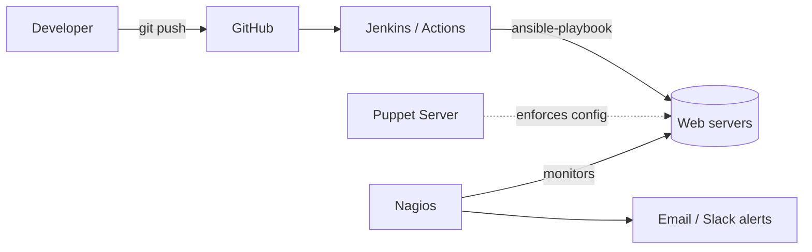

# 🚀 CA / Project template

Use this folder for the end-semester or CA project (e.g. *Provision a web server with Ansible, monitor it with Nagios, and keep config in Puppet*).

## Suggested structure
```
project/
├── README.md          # this file, filled in
├── architecture.md    # diagram + explanation
├── code/              # playbooks, manifests, nagios configs
└── screenshots/
```

## Report checklist
- [ ] Problem statement and objectives
- [ ] Architecture diagram (use Mermaid below)
- [ ] Tools & versions used
- [ ] Step-by-step implementation with screenshots
- [ ] Test cases and results
- [ ] Challenges faced and fixes
- [ ] Conclusion and future scope

## Architecture diagram starter

